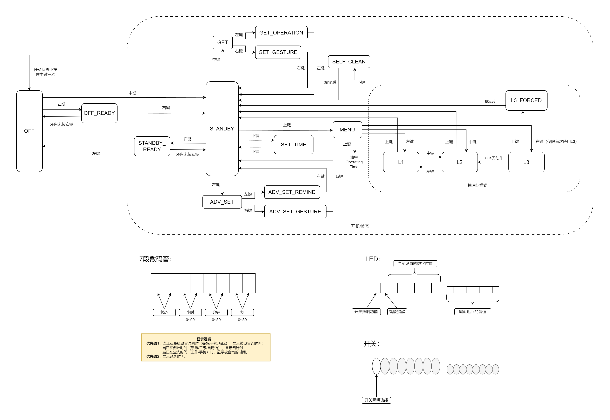

# FPGA Range Hood Controller (抽油烟机控制电路)

A Verilog HDL implementation of a range hood controller for the **SUSTech CS207 Digital Logic (2024 Fall)** course project, targeting the Xilinx Artix-7 FPGA (`xc7a35tcsg324-1`, EGO1 development board).



## Features

- **17-State FSM**: Manages power states (`OFF`, `OFF_READY`, `STANDBY`, `STANDBY_READY`), menu/mode transitions (`MENU`, `L1`, `L2`, `L3`, `L3_FORCED`, `SELF_CLEAN`), time & parameter configuration (`SET_TIME`, `ADV_SET`, `ADV_SET_REMIND`, `ADV_SET_GESTURE`), and status queries (`GET`, `GET_OPERATION`, `GET_GESTURE`).
- **Power & Gesture Control**:
  - Short-press `center` in `OFF` to power on into `STANDBY`.
  - Long-press `center` for **3s** in any state to force shutdown (`OFF`).
  - Two-step gesture simulation: `left` → `right` within the gesture window powers on; `right` → `left` powers off.
- **Fan Speeds & Self-Cleaning**:
  - `L1` / `L2`: Standard speeds with mutual switching and immediate return to `STANDBY`.
  - `L3` (Hurricane mode): Usable once per power-on; counts down and falls back to `L2`, or transitions to `L3_FORCED` → `STANDBY` if `up` is pressed.
  - `SELF_CLEAN`: Runs a cleaning countdown, returns to `STANDBY`, and resets the cumulative operating timer.
- **PS/2 Keyboard Time & Parameter Input**: Supports numeric input (`0`–`9`) via PS/2 keyboard (`keyboard_receive.v`, `key_to_bcd.v`) with per-digit blinking cursor for setting system time, smart cleaning reminder threshold, and gesture timeout.
- **Smart Cleaning Reminder & Lighting**: Tracks cumulative operating time (`operating_time`), asserts `l_leds[6]` when the threshold is reached, and toggles lighting (`l_leds[7]`) via `l_sws[7]` while powered on.
- **7-Segment Display & Audio Feedback**: Displays the 2-digit state ID (`00.`–`16.`) alongside `HH:MM:SS` on 8-digit 7-segment tubes (`tube_display.v`), and drives audio tones via `speaker` during `L1`, `L2`, and `center` press.

## Repository Structure

```text
.
├── src/
│   ├── main.v               # Top-level module, 17-state FSM, timers, display & audio control
│   ├── bcd_counter.v        # Parameterized HH:MM:SS BCD up/down counter
│   ├── bcd_to_tube.v        # 4-bit BCD to 7-segment decoder
│   ├── state_to_tube.v      # FSM state code (00.-16.) to 7-segment decoder
│   ├── tube_display.v       # 500 Hz multiplexed 8-digit 7-segment driver
│   ├── debouncer.v          # Push-button synchronizer and debouncer
│   ├── timer.v              # Configurable clock-cycle timer
│   ├── keyboard_receive.v   # PS/2 keyboard scancode receiver
│   └── key_to_bcd.v         # PS/2 scancode to 4-bit BCD mapper
├── constraints/
│   └── proj_const.xdc       # Pin assignments & 100 MHz clock constraint (EGO1 / xc7a35tcsg324-1)
├── sim/
│   └── test_bcd_counter.v   # Testbench for bcd_counter
└── docs/
    ├── fsm_diagram.png      # State machine & I/O layout diagram
    ├── fsm_diagram.drawio   # Editable draw.io source
    └── project_spec.pdf     # Course project specification (CS207 2024 Fall)
```

## Hardware I/O Mapping

| Signal | Direction | Description |
| :--- | :--- | :--- |
| `clk` | Input | 100 MHz onboard clock (`P17`) |
| `reset_n` | Input | Active-low reset (`P15`) |
| `up`, `down`, `left`, `right`, `center` | Input | 5-way navigation push buttons |
| `l_sws[7]` | Input | Lighting toggle switch (active when powered on) |
| `ps2_clk`, `ps2_data` | Input | PS/2 keyboard interface for digit entry |
| `tube_ena[7:0]`, `left_tube_content[7:0]`, `right_tube_content[7:0]` | Output | 8-digit 7-segment display (`[State(2)] [HH] [MM] [SS]`) |
| `l_leds[7:0]` | Output | `[7]` lighting status, `[6]` cleaning reminder, `[5:0]` digit cursor |
| `r_leds[7:0]` | Output | Last received PS/2 scancode (debug) |
| `speaker`, `speaker_enable` | Output | Buzzer audio output (active-low enable) |

## Build & Simulation

1. Create a new RTL project in **Xilinx Vivado** (tested on **2022.1**) targeting **`xc7a35tcsg324-1`**.
2. Add all files in `src/` as design sources, `constraints/proj_const.xdc` as constraints, and `sim/test_bcd_counter.v` as simulation sources.
3. Set `main` as the top module, then run **Synthesis**, **Implementation**, and **Generate Bitstream**.

> **Note on Demo Parameters**: In `src/main.v`, `DEFAULT_GP_TIME_COUNTER_RESET_VAL_LEVEL3` (`24'h00_00_11`, 11s) and `DEFAULT_GP_TIME_COUNTER_RESET_VAL_SELF_CLEANING` (`24'h00_00_15`, 15s) are shortened from the specification defaults (60s / 3 min) for hardware demonstration. Adjust these `localparam` values in `src/main.v` before synthesis if full durations are needed.
